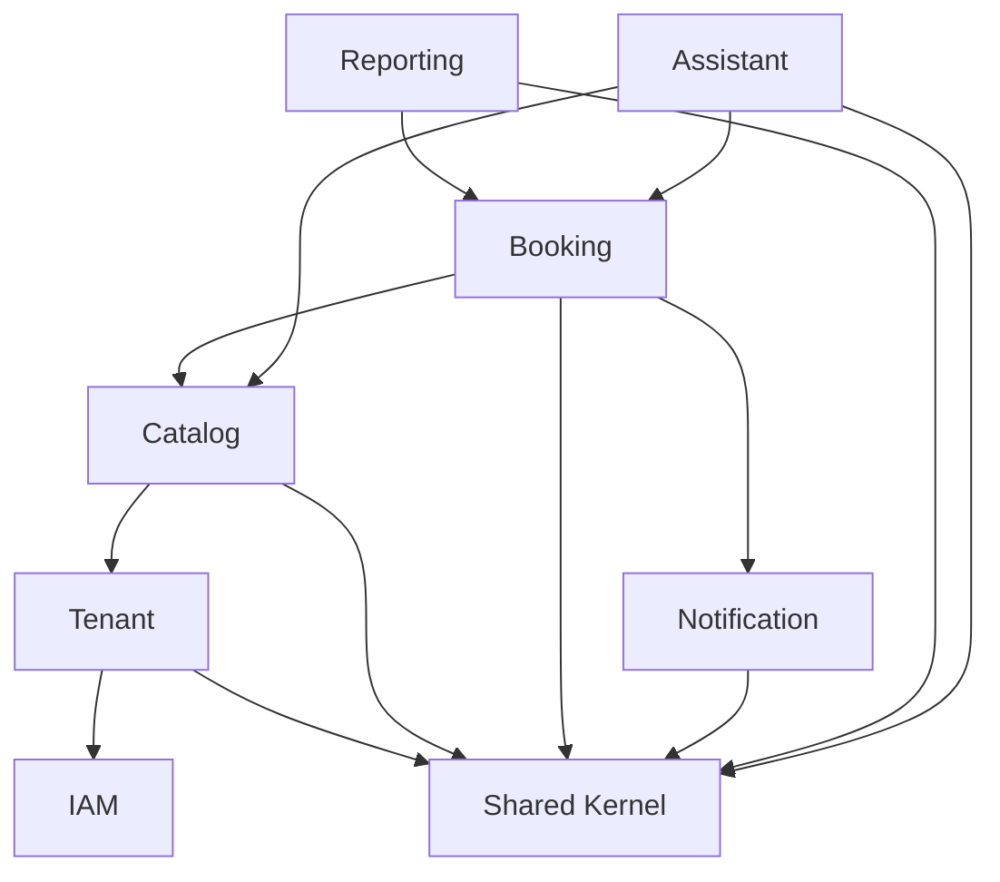

> **Exportado desde Confluence** · Espacio EXPERTIA-CAP26 · [Ver página original](https://maximilianodiazprofesional.atlassian.net/wiki/spaces/EXPERTIACA/pages/13959193) · versión 7 · última edición 2026-10-14

# Arquitectura de Software del Sistema

| Campo | Detalle |
| --- | --- |
| **Etapa** | 2 — Arquitectura de Software |
| **Versión** | 2.4 — el profesor guía confirma que no se requiere despliegue en AWS, basta un video de la demo (2026-10-14); v2.3: AWS SES no depende del resto del despliegue |
| **Rol aplicado** | Arquitecto de Software / Arquitecto AWS |
| **Última actualización** | 2026-09-24 |
| **Documentos de entrada** | `02-product-backlog.md`, `03-especificacion-requerimientos.md`, `04-casos-de-uso.md` |
| **Archivo fuente** | `05-arquitectura-software.md` |

## 1. Arquitectura Lógica

### 1.1 Estilo arquitectónico: Monolito Modular

El sistema se organiza como un **monolito modular** : un único desplegable (backend Django REST Framework) internamente dividido en **módulos con límites de dominio explícitos**  (bounded contexts, en terminología de Domain-Driven Design), cada uno responsable de un subconjunto acotado del negocio.

Esta decisión ya estaba dada como restricción del proyecto (RES-002), pero se formaliza aquí como **ADR-001**  para dejar registrada la justificación técnica completa.

### 1.2 Módulos identificados (bounded contexts)

Los primeros 6 módulos surgen directamente de las 6 épicas originales del Product Backlog y de sus grupos de RF en el SRS. Con la incorporación del Epic 7 (Asistente Conversacional), se agrega un **séptimo módulo, Assistant** .

| Módulo | Responsabilidad | Épica origen | RF cubiertos |
| --- | --- | --- | --- |
| **IAM**  (Identity & Access Management) | Registro, autenticación, roles y control de acceso | Epic 1 | RF-001 a RF-006 |
| **Tenant** | Gestión de negocios (onboarding, staff, datos generales) | Epic 2 | RF-007 a RF-011 |
| **Catalog** | Servicios, recursos y disponibilidad | Epic 3 | RF-012 a RF-017 |
| **Booking** | Motor de reservas — **dominio núcleo del sistema** | Epic 4 | RF-018 a RF-025 |
| **Notification** | Envío de comunicaciones transaccionales | Epic 5 | RF-026 a RF-028 |
| **Reporting** | Dashboard y reportes administrativos | Epic 6 | RF-029, RF-030 |
| **Assistant**  _(nuevo)_ | Orquestación conversacional del asistente: traduce lenguaje natural en invocaciones a Catalog y Booking | Epic 7 | RF-031 a RF-037 |

**Naturaleza particular del módulo Assistant:**  a diferencia de los otros 6 módulos, Assistant **no introduce reglas de negocio propias**  (RN-013). Su capa de Application no contiene lógica de dominio nueva: orquesta llamadas a los Application Services ya existentes de Catalog (disponibilidad, calificación) y Booking (creación de reserva), y delega la interpretación de lenguaje natural a un proveedor de LLM externo a través de un puerto de Infrastructure. Es, en términos de DDD, un módulo mayormente de **orquestación/fachada**  sobre dominio ya existente, no un bounded context con Aggregate Roots propios de negocio (sí tiene sus propias entidades de soporte: conversación e historial; ver `06-modelo-dominio.md`).

**Shared Kernel:**  módulo transversal, sin lógica de negocio propia, que contiene lo estrictamente necesario para que los demás módulos operen de forma consistente (referencia a Tenant, identificadores comunes, excepciones base, utilidades de fecha/hora). Se mantiene deliberadamente pequeño: un Shared Kernel que crece sin control es la forma más común en que un monolito modular termina degenerando en un monolito "de espagueti".

Ver diagrama de arquitectura lógica `arquitectura_logica_monolito_modular` (adjuntar como imagen en Confluence).

### 1.3 ADR-001 — Monolito Modular vs. Microservicios desde el inicio

**Contexto:**  El proyecto requiere una arquitectura evolutiva, capaz de escalar hacia microservicios en el futuro, pero debe construirse por un equipo de 3 personas en \~4 semanas de implementación efectiva (plan original; \~7,5 semanas, 23 sep–14 nov, tras la reprogramación del 2026-09-23).

**Decisión:**  Se adopta un monolito modular con bounded contexts explícitos, no microservicios desde el día uno.

**Justificación**

* Microservicios agregan complejidad operacional (orquestación, comunicación de red, consistencia eventual, observabilidad distribuida) que no se justifica para un equipo de 3 personas ni para el volumen de uso académico del proyecto (SUP-005).
* Un monolito modular bien diseñado (con módulos que no se acoplan por implementación, sino solo por interfaces) es el prerequisito real para poder extraer microservicios después. Ir directo a microservicios sin haber validado los límites de dominio es el error más común y costoso en este tipo de migraciones.
* Permite una única base de código, un único pipeline de CI/CD y un único esquema de base de datos en el MVP, reduciendo drásticamente el esfuerzo de DevOps dado el plazo.

**Alternativas consideradas y descartadas**

* _Microservicios desde el inicio:_  descartado por sobrecarga operacional incompatible con el plazo y el tamaño del equipo.
* _Monolito no modular (big ball of mud):_  descartado porque no cumple el requerimiento RNF-008 (evolución futura) ni RNF-011 (mantenibilidad).

**Consecuencias:**  Cada módulo debe comunicarse con los demás únicamente a través de interfaces explícitas (ver sección 3), nunca accediendo directamente a las tablas o repositorios de otro módulo. Esta disciplina es la que hace viable una futura extracción a microservicios.

## 2. Arquitectura de Software — Capas por Módulo

Cada módulo se estructura internamente siguiendo el mismo patrón de capas (arquitectura en capas con inspiración hexagonal/_ports and adapters_ ), para mantener consistencia y previsibilidad en el código.

| Capa | Responsabilidad | Ejemplo en el módulo Booking |
| --- | --- | --- |
| **API (Controller)** | Expone endpoints REST, valida formato de entrada, traduce HTTP ↔ modelo de aplicación | `BookingViewSet` (`views.py`) recibe la solicitud de reserva |
| **Application (Service)** | Orquesta casos de uso, coordina reglas de negocio, transacciones | `CrearReservaService` (`services.py`) implementa el flujo de UC-11 |
| **Domain** | Entidades, value objects y reglas de negocio puras (sin dependencias de framework) | Entidad `Booking`, regla RN-002 (no solapamiento) |
| **Infrastructure** | Persistencia (modelos del ORM de Django y `repositories.py`), adaptadores a servicios externos | `repositories.py` de Booking, adaptador a `NotificationPort` |

**Justificación de esta separación**

* La capa de **Domain**  sin dependencias de Django/DRF permite probar las reglas de negocio (RN-001 a RN-010) con pruebas unitarias puras, rápidas y sin necesidad de levantar base de datos. Esto es crítico dado que la Etapa 8 (QA) exigirá cobertura de pruebas con un plazo ajustado.
* Separar **Application**  de **Domain**  evita el antipatrón de "entidades anémicas con lógica en el service" y mantiene las reglas de negocio en un solo lugar, testeable de forma aislada.
* La capa de **Infrastructure**  aísla el motor de persistencia (PostgreSQL/ORM de Django) y los adaptadores externos (email), de modo que un cambio futuro (ej. cambiar el proveedor de email, o migrar de monolito a microservicio) no afecte el dominio ni la capa de aplicación.

### 2.1 ADR-002 — Comunicación entre módulos

**Contexto:**  Los módulos deben comunicarse (ej. Booking necesita datos de Catalog y dispara eventos hacia Notification), sin acoplarse a la implementación interna del otro módulo. Esta decisión quedó pendiente desde la Etapa 1.

**Decisión:**  La comunicación entre módulos se realiza mediante **interfaces explícitas ("ports",** `typing.Protocol` **de Python), invocadas de forma síncrona y en el mismo proceso** , no mediante un mecanismo de eventos o mensajería desacoplada.

_Ejemplo:_  el módulo Booking no importa clases internas de Notification. Depende únicamente de una interfaz `NotificationPort` (definida en el propio módulo Booking, o en un módulo de contratos compartido), que Notification implementa. Booking no sabe si esa implementación envía un email, un mensaje interno o, en una futura migración a microservicios, publica un evento en una cola.

**Justificación**

* Es la opción de menor complejidad de implementación y prueba, adecuada al plazo de 15 semanas y al riesgo de capacidad ya identificado en la Etapa 1 (92 story points Must-have).
* Al depender de interfaces y no de implementaciones concretas, el costo de migrar a un mecanismo de eventos asíncronos en el futuro queda **contenido dentro de la capa de Infrastructure**  de cada módulo; no obliga a modificar la lógica de Application ni Domain de los módulos consumidores.
* Evita introducir infraestructura de mensajería (colas, tópicos, manejo de fallos asíncronos, idempotencia) que no aporta valor directo a los objetivos académicos del proyecto de título.

**Alternativas consideradas y descartadas**

* _Bus de eventos interno (ej. señales de Django) desde el inicio:_  descartado para el MVP por complejidad adicional sin beneficio inmediato; queda documentado como evolución futura (ver sección 2.2).
* _Mensajería externa (RabbitMQ/SQS) desde el inicio:_  descartado por sobreingeniería para el alcance y plazo del proyecto.

**Consecuencias:**  Todo módulo que exponga funcionalidad a otros módulos debe declarar una interfaz pública explícita. Está prohibido que un módulo acceda directamente al repositorio (ORM) o a las entidades de otro módulo.

### 2.2 Evolución futura documentada (fuera del MVP)

Para la memoria de título, se deja documentado como trabajo futuro: reemplazar las implementaciones síncronas de los "ports" críticos (en particular `NotificationPort`) por una implementación basada en eventos internos (señales de Django) como paso intermedio, y eventualmente por mensajería externa si el módulo Booking se extrajera como microservicio independiente. Esta ruta de evolución es precisamente la que ADR-002 deja abierta sin costo de refactor mayor.

## 3. Diagrama de Módulos y Dependencias Permitidas

Confluence no renderiza Mermaid de forma nativa: usa una macro de Mermaid (Marketplace) o exporta el diagrama como imagen y adjúntala.

**Regla de dependencia:**  las flechas representan la única dirección permitida de dependencia. Un módulo "de abajo" (ej. IAM) **nunca**  puede depender de uno "de arriba" (ej. Booking). Esta regla se validará arquitectónicamente en la Etapa 4 (Diseño Backend), con `import-linter` (configurado en `.importlinter`, ya activo en el repositorio).

## 4. Arquitectura Física (vista preliminar — no se implementa, ver nota)

**Nota (2026-10-14):**  el profesor guía confirmó que el despliegue en AWS **no se requiere**  para la entrega (RES-009) — ya no es "diferido a confirmar", queda descartado. El sistema se desarrolla y demuestra en contenedores locales (PostgreSQL, backend Django, frontend Angular) con Docker Compose, y la entrega final se acompaña de un video de la demo. Esta sección se conserva como referencia de diseño (vista preliminar que se habría formalizado en la Etapa 6), no como trabajo pendiente.

Se adelanta aquí una vista de alto nivel de la arquitectura física prevista originalmente; no se implementa (Etapa 6 — Infraestructura AWS, descartada).

| Componente | Tecnología | Rol |
| --- | --- | --- |
| Frontend | Angular, compilado como assets estáticos | Servido vía S3 + CloudFront |
| Backend | Django REST Framework, empaquetado en contenedor Docker | Ejecutado en AWS ECS (Fargate) |
| Base de Datos | PostgreSQL | AWS RDS (instancia gestionada) |
| Balanceo de carga | Application Load Balancer (ALB) | Enruta tráfico HTTPS hacia el backend |
| Correo transaccional | AWS SES | Implementación del `NotificationPort` (RF-026 a RF-028) |
| Registro de contenedores | Amazon ECR | Almacena las imágenes Docker construidas en CI |
| CI/CD | GitHub Actions | Build, test y despliegue automatizado |

**Nota (2026-10-14):**  esta tabla describe el despliegue completo en AWS, diferido por RES-009. La fila de **correo transaccional (AWS SES)** es la excepción: no depende de que el resto de esta tabla (ECS, RDS, ALB, ECR) exista — solo necesita credenciales de API de SES, que el backend puede usar desde cualquier entorno, incluido Docker local. Por eso el adaptador real de `NotificationPort` puede implementarse en el Sprint 4 sin esperar al despliegue en AWS (ver SUP-006/DEP-005 en `01-4`).

### 4.1 ADR-003 — ECS Fargate vs. EC2 auto-gestionado

**Contexto:**  El backend containerizado necesita un entorno de ejecución en AWS.

**Decisión:**  Se utilizará **ECS con Fargate**  (contenedores gestionados, sin administración de instancias EC2 subyacentes).

**Justificación**

* Fargate elimina la necesidad de administrar parches de sistema operativo, escalado de instancias EC2 y configuración de clúster, tareas que consumen tiempo de DevOps que el equipo no tiene disponible dado el plazo.
* El costo para el volumen de tráfico académico esperado (SUP-005) es marginal y cabe dentro de un presupuesto mínimo (RES-005).
* Mantiene el requerimiento RNF-013 (contenerización con Docker) sin comprometer el cronograma.

**Alternativas consideradas y descartadas**

* _EC2 con contenedores auto-gestionados:_  mayor control, pero mayor carga operativa injustificada para el alcance del proyecto.
* _Elastic Beanstalk:_  simplifica el despliegue pero abstrae demasiado la configuración de infraestructura, restando valor pedagógico al componente de Arquitectura AWS que se evalúa en la memoria.

Esta decisión se detallará completamente, con diagrama de despliegue formal, en la Etapa 6.

### 4.2 ADR-005 — Integración del Asistente Conversacional vía puerto/adaptador LLM

**Contexto:**  El Epic 7 introduce dependencia de un proveedor externo de LLM (DEP-009) para interpretar lenguaje natural y ejecutar acciones sobre el dominio (consultar disponibilidad, recomendar profesional, crear reserva, responder FAQ). Existe un riesgo arquitectónico real si el LLM termina con acceso directo a repositorios o reglas de negocio: se duplicaría lógica ya validada en Catalog/Booking (RN-001, RN-002, RN-006) y se abriría una vía alterna para saltarse validaciones, exactamente lo que RN-013 prohíbe.

**Decisión:**  El módulo Assistant se integra al LLM mediante un **puerto/adaptador**  (`LlmProviderPort`, patrón idéntico al `NotificationPort` de ADR-002), y el LLM solo puede actuar sobre el sistema invocando un conjunto cerrado y explícito de **herramientas (tool calling)**  que son wrappers delgados sobre los Application Services ya existentes de Catalog y Booking. El LLM nunca recibe credenciales de base de datos, nunca importa repositorios, y nunca ejecuta SQL o lógica propia de negocio: solo decide _qué_  Application Service invocar y con _qué_  parámetros, en base a la conversación.

**Justificación**

* Es la única forma de garantizar RN-013 y RN-014 (mismas validaciones y mismos datos mínimos que el flujo web) sin duplicar reglas de negocio en un segundo lugar del código.
* Aísla la dependencia de un proveedor de LLM específico (SUP-008: requiere tool/function calling) en la capa de Infrastructure del módulo Assistant; cambiar de proveedor en el futuro no debería tocar Application ni Domain de ningún otro módulo.
* Habilita la degradación controlada exigida por RNF-018: si el proveedor de LLM falla, solo falla el adaptador de Infrastructure de Assistant; Catalog y Booking (y por lo tanto el flujo web tradicional) siguen operando con normalidad, porque nunca dependieron de Assistant.

**Alternativas consideradas y descartadas**

* _Dar al LLM acceso directo a la base de datos o a los repositorios (ej. mediante un ORM expuesto como herramienta genérica "ejecutar consulta"):_  descartado de forma categórica. Viola RN-013, duplica validaciones de negocio de forma no controlada, y es un riesgo de seguridad serio en un sistema multi-tenant (RNF-006).
* _Reimplementar las reglas de disponibilidad/reserva dentro del propio prompt o lógica del módulo Assistant:_  descartado porque duplicaría reglas ya probadas en Catalog/Booking, generando dos fuentes de verdad divergentes.

**Consecuencias:**  El catálogo de "herramientas" que el LLM puede invocar debe mantenerse deliberadamente pequeño y mapeado 1:1 a Application Services existentes (ej. `consultar_disponibilidad`, `crear_reserva`, `listar_recursos_calificados`). Cualquier nueva capacidad del asistente requiere primero que exista el Application Service correspondiente en Catalog o Booking; el asistente nunca es el lugar donde nace una regla de negocio nueva.

**Actualización 2026-09-23:**  el proveedor elegido para implementar `LlmProviderPort` en el MVP es **Google Gemini**  (ver RES-006 en `03-especificacion-requerimientos.md`). Además, el acceso al asistente queda condicionado al plan del tenant (RN-015): solo tenants en plan `PRO` exponen el canal conversacional, lo que acota el consumo del presupuesto aprobado a los tenants que efectivamente lo usan.

## 5. Trazabilidad de Requerimientos No Funcionales a Decisiones Arquitectónicas

| RNF | Cómo se cumple |
| --- | --- |
| RNF-006 (aislamiento multi-tenant) | El módulo IAM y Tenant, junto con el Shared Kernel, garantizan que todo acceso a datos pase por un filtro de `tenant_id`; se detalla en Etapa 3 (Modelo de Datos) y en `08-estructura-backend.md` (manager que obliga a filtrar por tenant) |
| RNF-008 (escalabilidad/evolución) | Bounded contexts + ADR-002 (comunicación por interfaces) permiten extracción futura sin reescritura completa |
| RNF-011 (mantenibilidad) | Capas Domain/Application/Infrastructure por módulo, con reglas de negocio aisladas y testeables |
| RNF-013 (portabilidad) | Contenerización Docker de frontend y backend |
| RNF-014 (CI/CD) | GitHub Actions como pipeline único, detallado en Etapa 7 |
| RNF-017 (rendimiento del asistente) | Puerto `LlmProviderPort` con timeout explícito; el asistente no bloquea otros módulos mientras espera al LLM |
| RNF-018 (degradación controlada) | ADR-005: Assistant depende de Catalog/Booking, nunca al revés; una falla del LLM no puede propagarse al flujo web |
| RNF-019 (protección de datos del historial de chat) | Historial de conversación aislado por `tenant_id`, mismas garantías que RNF-006; se detalla en Etapa 3 |

## 6. Cierre de esta actividad

### Objetivos cumplidos

* Arquitectura lógica definida: monolito modular con **7 bounded contexts**  (se agregó Assistant) + shared kernel.
* Arquitectura de software definida: capas API/Application/Domain/Infrastructure por módulo.
* Comunicación entre módulos resuelta y justificada (ADR-002), extendida al caso del LLM externo (ADR-005).
* Arquitectura física preliminar (AWS) esbozada, con justificación de Fargate (ADR-003).
* 5 ADRs formales documentados: monolito modular, comunicación intermódulos, cómputo AWS, framework backend Django (ver `08-estructura-backend.md` v2.0) e integración LLM vía puerto/adaptador.
* Diagrama lógico visual generado + diagrama de dependencias entre módulos (Mermaid), actualizado con Assistant.
* Trazabilidad completa RNF → decisión arquitectónica, incluyendo RNF-017 a RNF-019.

### Entregables

* `05-arquitectura-software.md` (v2.0)
* Diagrama `arquitectura_logica_monolito_modular`

### Documentación generada

Lista para el capítulo de "Arquitectura del Sistema" de la memoria, incluyendo los ADRs en formato estándar de la industria.

### Próximos pasos

Con la arquitectura lógica y de software actualizadas, corresponde propagar el módulo Assistant hacia:

1. `06-modelo-dominio.md` (entidades de conversación/calificación).
2. `07-modelo-base-datos.md` (tablas/columnas nuevas).
3. `08-estructura-backend.md` (nueva app Django `apps/assistant/`).

_Documento vivo — Etapa 2 (Arquitectura de Software)._

## Control de cambios

| Versión | Fecha | Cambio | Responsable |
| --- | --- | --- | --- |
| 2.0 | 2026-08-02 | Agrega módulo Assistant (Epic 7) y ADR-005 | Equipo del proyecto |
| 2.1 | 2026-09-23 | ADR-005: proveedor Google Gemini y acceso condicionado al plan PRO (RN-015); plazo de implementación según calendario reprogramado | Alberto Rincón |
| 2.2 | 2026-09-24 | Referencias a Spring/JPA/ArchUnit reemplazadas por Django/DRF/`import-linter` (coherencia con ADR-004); nota de AWS diferido | Alberto Rincón |
| 2.3 | 2026-10-14 | Aclara que AWS SES (correo transaccional) no depende del resto de la tabla de despliegue (ECS/RDS/ALB/ECR), que sigue diferida — el adaptador real de `NotificationPort` puede implementarse en el Sprint 4 solo con credenciales de API | Alberto Rincón |
| 2.4 | 2026-10-14 | El profesor guía confirma que el despliegue en AWS **no se requiere**  para la entrega — §4 se conserva como referencia de diseño, no como trabajo pendiente | Alberto Rincón |
