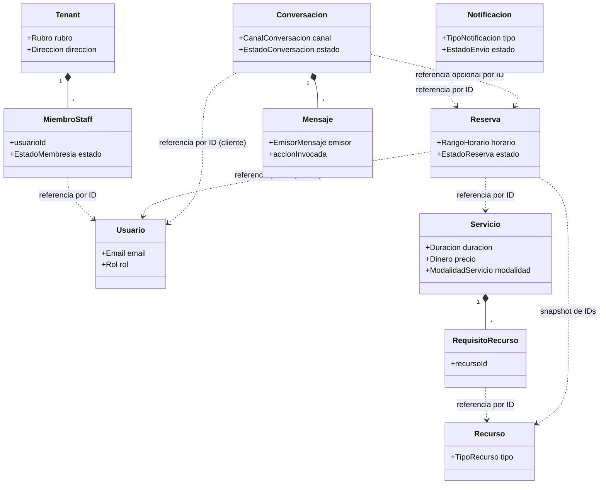

> **Exportado desde Confluence** · Espacio EXPERTIA-CAP26 · [Ver página original](https://maximilianodiazprofesional.atlassian.net/wiki/spaces/EXPERTIACA/pages/13729837) · versión 8 · última edición 2026-10-07

# Modelo de Dominio (DDD)

| Campo | Detalle |
| --- | --- |
| **Etapa** | 3 — Modelo de Datos (fase de modelado de dominio, previa al esquema físico) |
| **Versión** | 2.5 — `Usuario.nombre` (CAPDC-8, 2026-09-24); v2.4: `Tenant` con teléfono y correo de contacto; Dueño sin tenant hasta registrar su negocio |
| **Rol aplicado** | Arquitecto de Software / Arquitecto de Base de Datos |
| **Metodología** | Domain-Driven Design (entidades, objetos de valor, agregados, servicios de dominio, contextos delimitados) |
| **Documentos de entrada** | `05-arquitectura-software.md` (bounded contexts ya definidos como módulos) |
| **Archivo fuente** | `06-modelo-dominio.md` |

## 0. Decisión de modelado pendiente — Resuelta aquí

**Pregunta abierta desde la Etapa 2:**  ¿`Recurso` se modela como tabla única con tipo, o con herencia (tabla base + extensión por tipo)?

**Decisión:**  `Recurso` es una **única entidad**  con un objeto de valor `TipoRecurso` (profesional / sala / equipo) y atributos genéricos. La necesidad de "recurso compuesto" (ej. una cita de clínica que requiere sala **+**  equipo **+**  profesional simultáneamente) **no se resuelve mediante herencia de** `Recurso`, sino en el agregado `Servicio`, que declara **cuántos y qué tipo de recursos requiere**  para poder ejecutarse.

**Justificación:**  modelar `Recurso` con herencia por tipo (tabla `Recurso` + `RecursoProfesional`, `RecursoSala`, `RecursoEquipo`) resuelve un problema que no existe todavía (atributos específicos por tipo) a costa de un problema real: cada consulta de disponibilidad tendría que hacer join contra tablas distintas según el tipo, y el motor de reservas (el dominio núcleo del sistema) necesita tratar la disponibilidad de cualquier recurso de forma uniforme. Una sola entidad `Recurso` con tipo como Value Object mantiene el motor de disponibilidad simple (la ventaja competitiva identificada frente a [http://SimplyBook.me](http://SimplyBook.me) en el benchmark) y el "recurso compuesto" se resuelve a nivel de relación (`Servicio` ↔ `Recurso`), no de herencia.

## 1. Contextos Delimitados (Bounded Contexts)

Se mantienen los 6 contextos definidos en la Etapa 2, ahora con su modelo de dominio interno, y se agrega el **séptimo contexto, Assistant** , incorporado en la Etapa 2 (v2.0) junto con el Epic 7.

| Contexto | Tipo de contexto | Agregados propios |
| --- | --- | --- |
| IAM | Núcleo de soporte (autenticación) | Usuario |
| Tenant | Genérico de soporte | Tenant |
| Catalog | Núcleo de soporte | Servicio, Recurso |
| **Booking** | **Núcleo de negocio (core domain)** | Reserva |
| Notification | Genérico de soporte | Notificacion |
| Reporting | Genérico de soporte (solo lectura) | *(sin agregados propios: proyección de datos de Booking)* |
| **Assistant**  *(nuevo)* | Orquestación/fachada conversacional (sin reglas de negocio propias, RN-013) | Conversacion |

**Regla de integridad entre contextos:**  ningún agregado referencia a otro agregado por objeto directo. Todas las referencias cruzadas de contexto se hacen **por identidad (ID)** , nunca por composición de objetos. Esto es consistente con ADR-002 (comunicación entre módulos por interfaces, no por acceso directo a datos ajenos).

## 2. Contexto: IAM

### 2.1 Entidad — Usuario (Aggregate Root)

**Responsabilidad:**  representar la identidad autenticable de cualquier persona que interactúa con el sistema, y su rol de acceso. Es el único agregado del contexto; no tiene entidades hijas porque su ciclo de vida es autocontenido y no requiere invariantes compuestas.

| Atributo | Tipo |
| --- | --- |
| id | Identidad |
| email | VO `Email` |
| nombre *(nuevo v2.5)* | String |
| credenciales | VO `Credenciales` (hash de contraseña) |
| rol | VO `Rol` (SUPER_ADMIN, DUEÑO_NEGOCIO, STAFF, CLIENTE_FINAL) |
| tenantId | Referencia opcional (aplica a DUEÑO_NEGOCIO y STAFF; un Dueño no la tiene hasta registrar su negocio, RN-019) |
| estado | VO `EstadoCuenta` (activa/inactiva) |

### 2.2 Objetos de Valor

- **Email:**  inmutable, valida formato; dos emails son iguales si su valor lo es (sin identidad propia).
- **Credenciales:**  encapsula el hash de contraseña; nunca expone el valor en texto plano fuera de la infraestructura.
- **Rol:**  enumeración cerrada de los 4 roles del sistema (ver Sección 2 del SRS).
- **EstadoCuenta:**  activa / inactiva.

### 2.3 Servicio de Dominio

- **AutenticadorService:**  valida credenciales contra el hash almacenado y determina si una cuenta puede iniciar sesión. Es un servicio de dominio (no un método de `Usuario`) porque involucra política de seguridad (ej. intentos fallidos, futura expiración de sesión) que trasciende el estado de una sola entidad.

## 3. Contexto: Tenant

### 3.1 Entidad — Tenant (Aggregate Root)

**Responsabilidad:**  representar un negocio dado de alta en la plataforma y ser el punto de anclaje de aislamiento multi-tenant (RNF-006). Toda entidad de negocio en cualquier contexto porta una referencia a `Tenant.id`.

| Atributo | Tipo |
| --- | --- |
| id | Identidad |
| nombre | String |
| slug *(nuevo v2.3)* | VO `Slug` (identificador público único, RN-016) |
| rubro | VO `Rubro` |
| direccion | VO `Direccion` |
| telefono *(nuevo v2.4)* | String (opcional en el esquema, obligatorio al registrar) |
| emailContacto *(nuevo v2.4)* | VO `Email` (por defecto, el del Dueño) |
| horarioGeneral | VO `RangoHorario` |
| estado | VO `EstadoTenant` (activo/inactivo, controlado por Super Admin) |
| plan *(nuevo v2.2)* | VO `Plan` (basico / pro) |
| miembros | Colección de entidad interna `MiembroStaff` |
| contextoAsistente *(nuevo v2.0)* | VO `ContextoAsistente` (contenido de FAQ configurado para el asistente) |

### 3.2 Entidad interna — MiembroStaff (parte del agregado Tenant, no aggregate root propio)

**Responsabilidad:**  representar la vinculación de una cuenta de `Usuario` (contexto IAM) a este `Tenant` específico, con su estado de membresía. Se modela como entidad interna (no como aggregate root) porque su ciclo de vida depende completamente del `Tenant`: no tiene sentido de negocio fuera de él.

| Atributo | Tipo |
| --- | --- |
| id | Identidad (interna al agregado) |
| usuarioId | Referencia a `Usuario` (contexto IAM, por ID) |
| estado | VO `EstadoMembresia` (activo/inactivo) |
| fechaIngreso | Fecha |

### 3.3 Objetos de Valor

- **Rubro:**  vertical del negocio (ej. Salón de Belleza, Clínica/Consultorio); determina la plantilla de onboarding.
- **Direccion:**  calle, comuna, ciudad (inmutable, sin identidad).
- **RangoHorario:**  hora de inicio y fin (reutilizado también en Catalog).
- **EstadoTenant / EstadoMembresia:**  estados cerrados.
- **Slug**  *(nuevo v2.3)* : identificador público del tenant usado en la URL de reservas (`/:tenantSlug`). Se genera a partir del nombre (minúsculas, sin tildes, guiones), es único en toda la plataforma, tiene entre 3 y 50 caracteres `a-z 0-9 -` y no puede ser una palabra reservada de las rutas del sistema (RN-016). La unicidad y las palabras reservadas se validan en la capa de aplicación; la unicidad además la garantiza la base de datos.
- **Plan**  *(nuevo v2.2)* : `basico` / `pro`. Determina qué funcionalidades están habilitadas para el tenant — en el MVP, la única diferencia funcional relevante es el acceso al asistente conversacional (RN-015, exclusivo de `pro`); límites adicionales (cantidad de recursos/servicios) se validan en la capa de aplicación, no en el esquema. Se asigna manualmente: no hay pasarela de pago en el MVP (fuera de alcance). Es uno de los metadatos que el Super Admin sí puede consultar (RN-010).
- **ContextoAsistente**  *(nuevo)* : texto/estructura de contenido (horario, ubicación, políticas y otras preguntas frecuentes) que el Dueño de Negocio configura (RF-036) y que el contexto Assistant consulta en modo lectura para responder RF-037. Vive en `Tenant` (no en `Assistant`) porque es información propia del negocio, no del canal conversacional; `Assistant` lo referencia por `tenantId`, igual que cualquier otro dato de negocio.

### 3.4 Servicio de Dominio

- **AsistenteOnboardingService:**  dado un `Rubro`, determina qué plantilla de servicios y recursos sugerir. Es un servicio de dominio porque encapsula una regla de negocio (RN-007) que no pertenece naturalmente ni a `Tenant` ni a `Servicio`/`Recurso` (que están en otro contexto); actúa como puente y su resultado es consumido por la capa de aplicación para crear instancias en el contexto Catalog. La aplicación de la plantilla se ejecuta cuando existe el módulo Catalog (Sprint 2, US-005); en el Sprint 1 solo se registra el rubro (US-004).

## 3.5 Plantillas iniciales por rubro (RN-007)

Las plantillas son datos (no código): se almacenan como definiciones por rubro y `AsistenteOnboardingService` las consulta. Todos los servicios y recursos que crea la plantilla son editables y eliminables, y el Dueño puede omitir la plantilla y partir vacío (UC-03, A1). Un recurso sin disponibilidad configurada queda "no reservable" hasta que se defina (UC-08, A1). Los precios son referenciales, en CLP.

**Salón de belleza / peluquería**  (Escenario 1: profesional individual con alternativas, y Escenario 3: servicio grupal):

| Servicio | Duración | Precio | Recursos requeridos |
| --- | --- | --- | --- |
| Corte de cabello | 45 min | 15.000 | grupo 1: Profesional 1 o Profesional 2 (alternativas) |
| Coloración | 90 min | 45.000 | grupo 1: Profesional 1 o Profesional 2 (alternativas) |
| Manicure | 60 min | 18.000 | grupo 1: Profesional 2 |
| Taller de peinados (grupal, cupo 4) | 60 min | 12.000 | grupo 1: Sala de talleres |

Recursos: Profesional 1, Profesional 2 (tipo profesional) y Sala de talleres (tipo sala).

**Clínica / consultorio médico**  (Escenario 2: recurso compuesto):

| Servicio | Duración | Precio | Recursos requeridos |
| --- | --- | --- | --- |
| Consulta general | 30 min | 20.000 | grupo 1: Profesional 1 o Profesional 2 (alternativas) |
| Consulta especialista | 45 min | 35.000 | grupo 1: Box 1; grupo 2: Equipo médico; grupo 3: Profesional 2 (los tres a la vez) |
| Control de enfermería | 20 min | 8.000 | grupo 1: Enfermería |

Recursos: Box 1 (sala), Equipo médico (equipo), Profesional 1, Profesional 2 y Enfermería (tipo profesional).

## 4. Contexto: Catalog

### 4.1 Entidad — Servicio (Aggregate Root)

**Responsabilidad:**  representar un servicio ofrecido por el negocio, con su duración, precio y los recursos que requiere para ejecutarse. Es el agregado que resuelve la necesidad de "recurso compuesto" (ver Sección 0).

| Atributo | Tipo |
| --- | --- |
| id | Identidad |
| tenantId | Referencia |
| nombre | String |
| duracion | VO `Duracion` |
| precio | VO `Dinero` |
| modalidad | VO `ModalidadServicio` (individual / grupal) |
| cupoMaximo | Entero (solo si modalidad = grupal) |
| estado | VO `EstadoServicio` (activo/inactivo) |
| recursosRequeridos | Colección de entidad interna `RequisitoRecurso` |

### 4.2 Entidad interna — RequisitoRecurso (parte del agregado Servicio)

**Responsabilidad:**  declarar qué recurso(s) necesita este servicio para poder ejecutarse, distinguiendo dos necesidades distintas que el modelo debe representar por separado:

- **Recursos alternativos**  (Escenario 1, ej. peluquería): el servicio necesita **uno cualquiera**  de un conjunto de recursos intercambiables (ej. cualquiera de 3 estilistas puede hacer un "Corte de cabello"). El cliente elige uno al reservar.
- **Recurso compuesto**  (Escenario 2, ej. clínica): el servicio necesita **todos**  los recursos de un conjunto **a la vez**  (ej. Box + Equipo + Profesional simultáneamente para una "Consulta médica").

Ambos casos se modelan con la misma entidad `RequisitoRecurso`, mediante un atributo `grupo` (entero): los `RequisitoRecurso` que comparten el mismo `grupo` son alternativas entre sí (el grupo se satisface eligiendo **uno**  de ellos); cada `grupo` distinto dentro del mismo `Servicio` debe satisfacerse de forma independiente y simultánea con los demás grupos. Así:

- Escenario 1 (individual con alternativas): 1 solo grupo, con N `RequisitoRecurso` (uno por profesional intercambiable).
- Escenario 2 (compuesto): N grupos de 1 `RequisitoRecurso` cada uno (ej. grupo 1 = Sala, grupo 2 = Equipo, grupo 3 = Profesional) — se reservan los 3 a la vez.
- Un servicio puede combinar ambos: por ejemplo, un grupo con varias salas alternativas + un grupo con un equipo fijo + un grupo con varios profesionales alternativos.

| Atributo | Tipo |
| --- | --- |
| id | Identidad interna |
| recursoId | Referencia a `Recurso` (por ID) |
| grupo | Entero (agrupa alternativas; recursos con el mismo `grupo` son intercambiables entre sí) |

**Nota de actualización (v2.1, 2026-09-23):**  la redacción original (v2.0) de esta entidad asumía que *todos*  los recursos asociados a un `Servicio` eran obligatorios simultáneamente, lo cual representaba correctamente el Escenario 2 (recurso compuesto) pero no dejaba espacio para el Escenario 1 con más de un profesional intercambiable — el caso más común en la práctica (una peluquería con varios estilistas que ofrecen el mismo servicio). El atributo `grupo` resuelve esto sin introducir una entidad nueva ni reabrir la decisión ya tomada en la Sección 0 (`Recurso` como entidad única sin herencia). Cambio impulsado por la validación de un mockup funcional (`expertia-mockup_1.3.html`) que evidenció que el modelo documentado no alcanzaba a representar ambos escenarios a la vez.

### 4.3 Entidad — Recurso (Aggregate Root, independiente de Servicio)

**Responsabilidad:**  representar cualquier elemento reservable del negocio (profesional, sala o equipo) y su disponibilidad. Es un agregado separado de `Servicio` porque su ciclo de vida es independiente: un recurso puede existir, cambiar su disponibilidad o desactivarse sin que ello dependa de un servicio específico, y puede estar asociado a varios servicios a la vez.

| Atributo | Tipo |
| --- | --- |
| id | Identidad |
| tenantId | Referencia |
| nombre | String |
| tipo | VO `TipoRecurso` (profesional / sala / equipo) |
| estado | VO `EstadoRecurso` (activo/inactivo) |
| calificacion *(nuevo v2.0)* | VO opcional `Calificacion` (asignación manual, RN-011) |
| usuarioId *(nuevo v2.3)* | Referencia opcional a `Usuario` (IAM), por ID. Solo para recursos de tipo profesional; una cuenta se vincula a lo más a un recurso (RN-017) |
| disponibilidadBase | Colección de entidad interna `DisponibilidadRecurrente` |
| excepciones | Colección de entidad interna `ExcepcionDisponibilidad` |

### 4.4 Entidades internas del agregado Recurso

- **DisponibilidadRecurrente:**  día de la semana + rango horario recurrente (ej. lunes 9:00–18:00).
- **ExcepcionDisponibilidad:**  fecha puntual + indicador de bloqueo (ausencia, feriado) que se resta de la disponibilidad recurrente.

### 4.5 Objetos de Valor

- **Duracion:**  minutos, mayor a cero.
- **Dinero:**  monto + moneda (moneda fija para el MVP, ver SUP de RES-007).
- **ModalidadServicio:**  individual / grupal.
- **TipoRecurso:**  profesional / sala / equipo.
- **EstadoServicio / EstadoRecurso:**  activo/inactivo.
- **Calificacion**  *(nuevo)* : valor numérico decimal en escala 1.0–5.0, opcional. Se modela como VO simple (no como un agregado propio de reseñas/reviews) porque la decisión resuelta con el usuario fue mantener el alcance simple: la calificación es asignada manualmente por el Dueño de Negocio (RN-011), no calculada a partir de reseñas de clientes tras la cita. Es una decisión de alcance deliberada, no una limitación técnica: si en el futuro se evoluciona a un sistema de reseñas post-cita, `Calificacion` se reemplazaría por un agregado propio sin afectar el resto del modelo, porque `Recurso` solo expone su valor actual, no cómo se calculó.

### 4.6 Servicios de Dominio

- **CalculadorDisponibilidadService:**  dado un `Servicio` (con sus `RequisitoRecurso`) y un rango de fechas, calcula los bloques horarios disponibles. Desde v2.1, el cálculo opera **por grupo**  (ver §4.2): para cada `grupo` de `RequisitoRecurso`, determina qué recurso(s) alternativos de ese grupo están disponibles; un bloque horario es válido solo si **todos**  los grupos del servicio tienen al menos un recurso disponible en simultáneo. El resultado expone, por bloque horario, las combinaciones posibles (una opción de recurso por grupo), para que `RecomendadorRecursoService` y la capa de aplicación puedan priorizar por calificación dentro de cada grupo con alternativas. Es un servicio de dominio porque opera sobre múltiples instancias de `Recurso` a la vez (no pertenece a una sola instancia), y es el componente que sostiene el requerimiento RF-018.
- **RecomendadorRecursoService**  *(nuevo v2.0)* : dado un conjunto de recursos disponibles para un servicio y horario (resultado de `CalculadorDisponibilidadService`), los ordena de mayor a menor `Calificacion` (RN-012), dejando sin priorizar explícita a los recursos sin calificación asignada. Es un servicio de dominio porque opera sobre múltiples instancias de `Recurso` a la vez y su resultado es consumido por el contexto Assistant (UC-21), nunca por el flujo web tradicional (que no distingue por calificación).

## 5. Contexto: Booking (dominio núcleo)

### 5.1 Entidad — Reserva (Aggregate Root)

**Responsabilidad:**  representar una cita agendada, su estado a lo largo de su ciclo de vida, y garantizar las invariantes críticas del negocio (no solapamiento, respeto de cupo). Es el **agregado más importante del sistema** , el que sostiene la propuesta de valor central.

| Atributo | Tipo |
| --- | --- |
| id | Identidad |
| tenantId | Referencia |
| servicioId | Referencia a `Servicio` (contexto Catalog, por ID) |
| recursosAsignados | Colección de referencias a `Recurso` (snapshot al momento de crear la reserva) |
| clienteId / clienteInfo | Referencia a `Usuario` con rol Cliente Final, o VO `DatosCliente` si no requiere cuenta |
| horario | VO `RangoHorario` |
| estado | VO `EstadoReserva` (pendiente, confirmada, cancelada, completada, no-show) |
| codigoConfirmacion | VO `CodigoConfirmacion` |
| tokenCancelacion | VO `TokenCancelacion` |

**Nota de diseño:**  `recursosAsignados` se guarda como snapshot (copia de los IDs de recurso al momento de la reserva), no como referencia dinámica al `RequisitoRecurso` del `Servicio`. Esto es intencional: si el negocio cambia la configuración del servicio después, las reservas ya creadas no deben verse afectadas retroactivamente.

### 5.2 Objetos de Valor

- **RangoHorario:**  fecha + hora inicio + hora fin (reutilizado, mismo VO que en Catalog; vive en el Shared Kernel).
- **EstadoReserva:**  enumeración con transiciones válidas controladas (pendiente → confirmada → {cancelada | completada | no-show}). Las transiciones inválidas (ej. cancelar una reserva ya completada) son responsabilidad de esta entidad, no de la capa de aplicación.
- **CodigoConfirmacion:**  identificador corto, único, mostrado al cliente.
- **TokenCancelacion:**  identificador no adivinable, de un solo uso, que sostiene RF-025/RN-009.
- **DatosCliente:**  nombre + contacto, para el caso donde el cliente final reserva sin crear cuenta formal (a resolver como alcance en Etapa 4).

### 5.3 Servicio de Dominio

- **ValidadorDisponibilidadService:**  antes de confirmar una reserva, valida las reglas RN-001 (disponibilidad configurada), RN-002 (no solapamiento) y RN-006 (cupo grupal), consultando las reservas existentes del mismo recurso y la disponibilidad calculada por `CalculadorDisponibilidadService` (contexto Catalog, invocado vía interfaz cross-context). Es un servicio de dominio porque su decisión depende de múltiples instancias de `Reserva` a la vez; no puede ser responsabilidad de una sola instancia.

## 6. Contexto: Notification

### 6.1 Entidad — Notificacion (Aggregate Root)

**Responsabilidad:**  representar el registro de un envío de comunicación transaccional y su resultado, con fines de trazabilidad y reintento.

| Atributo | Tipo |
| --- | --- |
| id | Identidad |
| tipo | VO `TipoNotificacion` (confirmación, recordatorio, cancelación, aviso a negocio) |
| destinatario | VO `Email` (reutilizado del contexto IAM / Shared Kernel) |
| reservaId | Referencia a `Reserva` (por ID) |
| estado | VO `EstadoEnvio` (pendiente, enviado, fallido) |

### 6.2 Servicio de Dominio

- **EnvioNotificacionService:**  construye el contenido del mensaje según `TipoNotificacion` y lo envía a través del `NotificationPort` (definido en la arquitectura de software, Etapa 2). Es la implementación concreta de ese puerto desde la perspectiva del dominio.

## 7. Contexto: Reporting

**Naturaleza distinta:**  este contexto **no tiene agregados propios con invariantes de negocio** . Es un contexto de solo lectura (proyección) sobre datos que ya existen en el contexto Booking. Se modela con objetos de valor de proyección, no con entidades transaccionales:

- **ResumenOcupacion**  (VO de proyección): citas del día, citas de la semana, porcentaje de ocupación por recurso.
- **ReporteMensual**  (VO de proyección): listado agregado de reservas de un mes, listo para exportar.

**Justificación de no modelarlo con agregados propios:**  forzar un agregado transaccional en un contexto que solo lee y presenta datos añadiría complejidad sin beneficio. Es el mismo principio de "no funcionalidades innecesarias" aplicado al modelado, no solo al alcance.

## 8. Contexto: Assistant *(nuevo en v2.0)*

**Naturaleza distinta**  (ver también `05-arquitectura-software.md`, sección 1.2): Assistant no introduce reglas de negocio de reserva o catálogo; esas siguen siendo responsabilidad exclusiva de Booking y Catalog (RN-013). Su único agregado propio existe para dar soporte a la conversación en sí (historial, trazabilidad), no para representar el dominio de negocio. Desde v2.2, el acceso al canal conversacional está además condicionado a que `Tenant.plan = pro` (RN-015); esta verificación vive en la capa de aplicación/permisos de `assistant`, no es una regla de dominio de Booking/Catalog.

### 8.1 Entidad — Conversacion (Aggregate Root)

**Responsabilidad:**  representar el intercambio conversacional entre un cliente final y el asistente, y sostener su historial con fines de auditoría y trazabilidad (RF de US-028).

| Atributo | Tipo |
| --- | --- |
| id | Identidad |
| tenantId | Referencia |
| clienteId / clienteInfo | Referencia a `Usuario`, o VO `DatosCliente` (reutilizado del contexto Booking) si no tiene cuenta |
| canal | VO `CanalConversacion` (para el MVP: único valor "chat_web") |
| estado | VO `EstadoConversacion` (activa, finalizada) |
| mensajes | Colección de entidad interna `Mensaje` |
| reservaResultanteId | Referencia opcional a `Reserva` (contexto Booking, por ID); se completa solo si la conversación terminó en una reserva creada (UC-22) |

### 8.2 Entidad interna — Mensaje (parte del agregado Conversacion)

**Responsabilidad:**  representar un turno individual de la conversación (del cliente o del asistente), incluyendo qué acción/herramienta fue invocada si corresponde. Se modela como entidad interna, no como aggregate root, porque un mensaje no tiene sentido de negocio fuera de su conversación.

| Atributo | Tipo |
| --- | --- |
| id | Identidad interna |
| emisor | VO `EmisorMensaje` (cliente / asistente) |
| contenido | Texto |
| accionInvocada | Referencia opcional al nombre del Application Service invocado (ej. "consultar_disponibilidad", "crear_reserva"): trazabilidad de qué hizo el asistente, no reimplementación de esa lógica |
| timestamp | Fecha/hora |

### 8.3 Objetos de Valor

- **CanalConversacion:**  único valor en el MVP ("chat_web"); VO preparado para una futura extensión a otros canales (ej. WhatsApp, explícitamente fuera del MVP según `02-product-backlog.md`).
- **EstadoConversacion:**  activa / finalizada.
- **EmisorMensaje:**  cliente / asistente.

**Nota de diseño: por qué** `Conversacion`**es un agregado y no solo un log plano.**  Aunque el contenido es principalmente de trazabilidad, se modela como agregado (no como filas sueltas sin invariante) porque tiene una invariante propia: los `Mensaje` deben mantener orden cronológico y pertenecer a una única `Conversacion`, y el campo `reservaResultanteId` debe completarse de forma atómica junto con el cierre de la conversación cuando corresponde.

### 8.4 Servicio de Dominio

- **OrquestadorAsistenteService:**  dado un mensaje entrante del cliente, determina (a partir de la interpretación del LLM vía `LlmProviderPort`, ver ADR-005) cuál Application Service de Catalog o Booking invocar y con qué parámetros, y registra el resultado como nuevo `Mensaje`. Es el único punto del sistema donde el módulo Assistant "decide" algo, y esa decisión nunca es una regla de negocio nueva: es un ruteo hacia lógica ya existente (RN-013).

## 9. Relaciones entre Contextos (vista consolidada)

Confluence no renderiza Mermaid de forma nativa: usa una macro de Mermaid (Marketplace) o exporta el diagrama como imagen y adjúntala.

**Lectura del diagrama:**  las líneas sólidas con rombo (`*--`) representan composición dentro de un mismo agregado (ej. `MiembroStaff` no existe sin `Tenant`). Las líneas punteadas (`..>`) representan referencias cruzadas de contexto **por identidad** , nunca por objeto; es la representación gráfica directa de la regla de integridad de la Sección 1.

## 10. Tabla Resumen — Servicios de Dominio

| Servicio de Dominio | Contexto | Por qué no es un método de entidad |
| --- | --- | --- |
| AutenticadorService | IAM | Involucra política de seguridad transversal, no solo el estado de un `Usuario` |
| AsistenteOnboardingService | Tenant | Cruza hacia el contexto Catalog; no pertenece a una sola entidad |
| CalculadorDisponibilidadService | Catalog | Opera sobre múltiples `Recurso` a la vez |
| RecomendadorRecursoService *(nuevo)* | Catalog | Opera sobre múltiples `Recurso` a la vez; consumido por Assistant |
| ValidadorDisponibilidadService | Booking | Opera sobre múltiples `Reserva` existentes a la vez (dominio núcleo) |
| EnvioNotificacionService | Notification | Orquesta el envío a través de un puerto de infraestructura |
| OrquestadorAsistenteService *(nuevo)* | Assistant | Rutea la interpretación del LLM hacia Application Services de otros contextos; no contiene regla de negocio propia |

## 11. Cierre de esta actividad

### Objetivos cumplidos

- 8 entidades principales (agregados) + 6 entidades internas modeladas con su responsabilidad explícita (se agregó `Conversacion`/`Mensaje` del contexto Assistant).
- 15 objetos de valor identificados y justificados (se agregaron `Calificacion` y `ContextoAsistente`).
- Decisión de modelado de `Recurso` resuelta (tabla única + VO de tipo, no herencia), extendida en v2.0 con `Calificacion` como VO opcional, sin reabrir la decisión de herencia.
- 7 servicios de dominio identificados y justificados (se agregaron `RecomendadorRecursoService` y `OrquestadorAsistenteService`).
- Relaciones entre contextos consolidadas, respetando la regla de referencia por ID.
- Diagrama de clases del modelo de dominio generado en notación Mermaid, actualizado con el contexto Assistant.

### Entregables

- `06-modelo-dominio.md` (v2.0)

### Documentación generada

Lista para el capítulo de "Modelo de Dominio" de la memoria, con el diagrama de clases embebido.

### Próximos pasos

Con el modelo de dominio actualizado, corresponde propagar `Calificacion`, `ContextoAsistente`, `Conversacion` y `Mensaje` hacia `07-modelo-base-datos.md` como columnas/tablas físicas concretas.

*Documento vivo — Etapa 3 (Modelo de Datos), fase de modelado de dominio.*

## Control de cambios

| Versión | Fecha | Cambio | Responsable |
| --- | --- | --- | --- |
| 2.0 | 2026-08-02 | Agrega contexto Assistant, `Calificacion` (Catalog) y `contextoAsistente` (Tenant) | Equipo del proyecto |
| 2.1 | 2026-09-23 | `RequisitoRecurso.grupo` para distinguir recursos alternativos de recurso compuesto; `CalculadorDisponibilidadService` por grupo | Alberto Rincón |
| 2.2 | 2026-09-23 | `Tenant.plan` (VO Plan, RN-015) y acceso condicionado del asistente | Alberto Rincón |
| 2.3 | 2026-09-24 | `Tenant.slug` (VO Slug, RN-016); `Recurso.usuarioId` (RN-017); §3.5 plantillas iniciales por rubro; US-005 se aplica en el Sprint 2 | Alberto Rincón |
| 2.4 | 2026-09-24 | `Tenant.telefono` y `Tenant.emailContacto`; `Usuario.tenantId` vacío para un Dueño sin negocio | Alberto Rincón |
| 2.5 | 2026-09-24 | `Usuario.nombre` (dato que pide UC-01) | Alberto Rincón |
