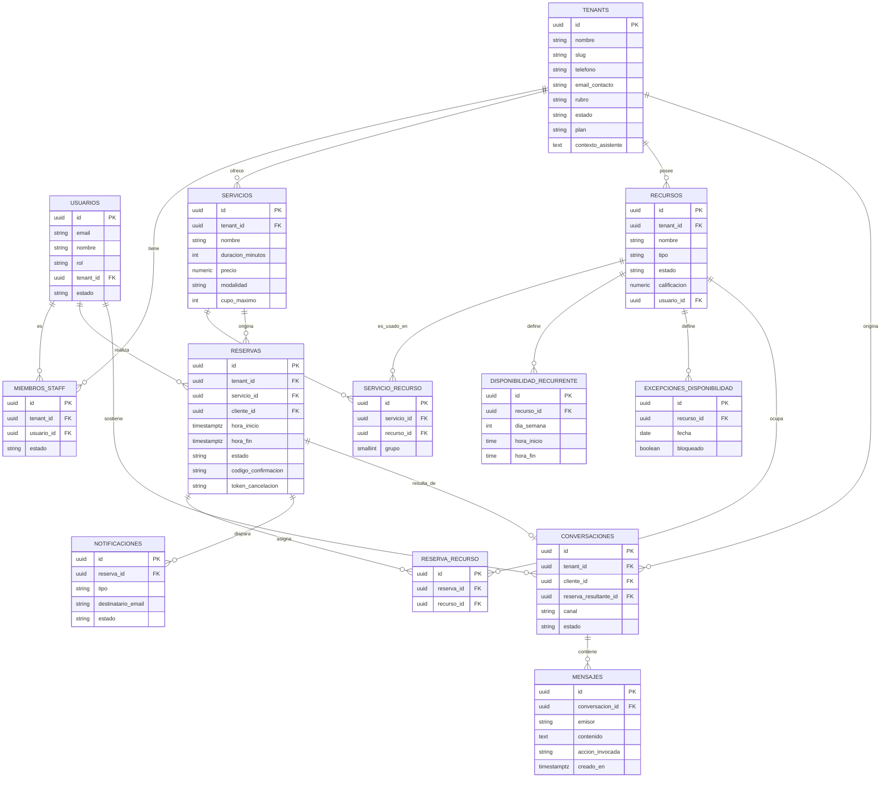

> **Exportado desde Confluence** · Espacio EXPERTIA-CAP26 · [Ver página original](https://maximilianodiazprofesional.atlassian.net/wiki/spaces/EXPERTIACA/pages/14024719) · versión 6 · última edición 2026-10-07

# Diseño de Base de Datos

| Campo | Detalle |
| --- | --- |
| **Etapa** | 3 — Modelo de Datos (fase final: esquema físico PostgreSQL) |
| **Versión** | 2.6 — `miembros_staff` con `created_at`/`updated_at` (CAPDC-13, 2026-10-03); v2.5: `usuarios.nombre` |
| **Rol aplicado** | Arquitecto de Base de Datos PostgreSQL |
| **Entrada** | `06-modelo-dominio.md` (agregados, entidades, value objects) |
| **Última actualización** | 2026-10-03 |
| **Archivo fuente** | `07-modelo-base-datos.md` |

## 1. De Dominio a Base de Datos — Criterio de Traducción

Cada agregado del modelo de dominio se traduce a una o más tablas. Regla aplicada de forma consistente:

| Elemento del dominio | Traducción a base de datos |
| --- | --- |
| **Aggregate Root** | Tabla propia con clave primaria. |
| **Entidad interna del agregado**  (ej. `MiembroStaff`, `RequisitoRecurso`) | Tabla propia con clave foránea al agregado padre; nunca se fusiona dentro de la tabla del padre (evita listas/JSON disfrazando una relación 1:N, lo que violaría 1NF). |
| **Value Object sin identidad**  (ej. `Direccion`, `RangoHorario`) | Columnas atómicas dentro de la tabla de la entidad que lo contiene; nunca tabla propia (no tiene identidad ni ciclo de vida propio). |
| **Referencia cruzada de contexto por ID**  (regla de la Sección 1 del modelo de dominio) | Clave foránea directa, sin tabla intermedia salvo que la relación sea muchos-a-muchos (ej. `Servicio` ↔ `Recurso`). |

## 2. Diagrama Entidad-Relación (DER)

Ver el diagrama `der_nucleo_reservas` para el núcleo de reservas (adjuntar como imagen). A continuación, el DER completo del sistema, incluyendo IAM, Tenant, Notification y Assistant.



Confluence no renderiza Mermaid de forma nativa: usa una macro de Mermaid (Marketplace) o exporta el diagrama como imagen y adjúntala.

## 3. Modelo Lógico

Vista tecnológicamente neutra: entidades, atributos conceptuales y cardinalidades, antes de fijar tipos específicos de PostgreSQL.

| Entidad | Atributos clave | Relaciones |
| --- | --- | --- |
| Tenant | nombre, slug, rubro, dirección, horario general, estado, plan | 1 Tenant → N MiembroStaff, N Servicio, N Recurso |
| Usuario | email, rol, estado | 1 Usuario → N MiembroStaff (0 o 1 en la práctica), N Reserva (como cliente) |
| MiembroStaff | estado, fecha de ingreso | N:1 con Tenant, N:1 con Usuario |
| Servicio | nombre, duración, precio, modalidad, cupo máximo | N:1 con Tenant, N:M con Recurso (vía RequisitoRecurso), 1:N con Reserva |
| Recurso | nombre, tipo, estado, calificación, usuario vinculado (opcional) | N:1 con Tenant, N:M con Servicio, 1:N con DisponibilidadRecurrente, 1:N con ExcepcionDisponibilidad |
| RequisitoRecurso | grupo (agrupa alternativas, v2.1) | Resuelve N:M entre Servicio y Recurso; recursos del mismo `grupo` son alternativos, grupos distintos son simultáneos (recurso compuesto) |
| DisponibilidadRecurrente | día semana, hora inicio, hora fin | N:1 con Recurso |
| ExcepcionDisponibilidad | fecha, bloqueado | N:1 con Recurso |
| Reserva | horario, estado, código confirmación, token cancelación | N:1 con Servicio, N:1 con Usuario (cliente), N:M con Recurso (vía snapshot) |
| ReservaRecurso | — (tabla de asociación / snapshot) | Resuelve N:M entre Reserva y Recurso |
| Notificacion | tipo, destinatario, estado | N:1 con Reserva |
| Conversacion _(nuevo)_ | canal, estado, reserva resultante (opcional) | N:1 con Tenant, N:1 con Usuario (cliente), 1:N con Mensaje, 0:1 con Reserva |
| Mensaje _(nuevo)_ | emisor, contenido, acción invocada, timestamp | N:1 con Conversacion |

### Cardinalidades críticas a destacar

* `Servicio` ↔ `Recurso` es **N:M** : es la relación que sostiene el modelo genérico. Desde v2.1, la columna `grupo` de `servicio_recurso` distingue si esos N recursos son alternativos entre sí (ej. varios estilistas intercambiables en peluquería, mismo `grupo`) o recursos compuestos que se reservan todos a la vez (ej. Box + Equipo + Profesional en clínica, `grupo` distinto cada uno).
* `Reserva` ↔ `Recurso` también es **N:M** , pero representa un _snapshot_  al momento de la reserva, no la configuración vigente del servicio (ver justificación en el modelo de dominio, Sección 5).

## 4. Modelo Físico (PostgreSQL)

### Extensiones requeridas

```
CREATE EXTENSION IF NOT EXISTS pgcrypto;   -- gen_random_uuid()
CREATE EXTENSION IF NOT EXISTS btree_gist; -- soporte para EXCLUDE con igualdad + rango
```

### 4.1 Tabla `tenants`

```
CREATE TABLE tenants (
    id UUID PRIMARY KEY DEFAULT gen_random_uuid(),
    nombre VARCHAR(150) NOT NULL,
    slug VARCHAR(50) NOT NULL UNIQUE
        CHECK (slug ~ '^[a-z0-9]+(-[a-z0-9]+)*$' AND char_length(slug) >= 3),
    rubro VARCHAR(30) NOT NULL CHECK (rubro IN ('SALON_BELLEZA','CLINICA','GIMNASIO','OTRO')),
    calle VARCHAR(150),
    comuna VARCHAR(100),
    ciudad VARCHAR(100),
    horario_apertura TIME,
    horario_cierre TIME,
    telefono VARCHAR(20),
    email_contacto VARCHAR(255),
    estado VARCHAR(20) NOT NULL DEFAULT 'ACTIVO' CHECK (estado IN ('ACTIVO','INACTIVO')),
    plan VARCHAR(10) NOT NULL DEFAULT 'BASICO' CHECK (plan IN ('BASICO','PRO')),
    contexto_asistente TEXT,
    created_at TIMESTAMPTZ NOT NULL DEFAULT now(),
    updated_at TIMESTAMPTZ NOT NULL DEFAULT now(),
    CHECK (horario_cierre IS NULL OR horario_apertura IS NULL OR horario_cierre > horario_apertura)
);
```

`plan`**(nuevo en v2.2):**  `VARCHAR(10)`, valores `BASICO`/`PRO`, default `BASICO`. No existe pasarela de pago en el MVP (fuera de alcance, `02-product-backlog.md` §10); el plan se asigna manualmente. Es uno de los metadatos que el Super Admin sí puede consultar (RN-010). La única diferencia funcional del MVP ligada al plan es el acceso al asistente conversacional, exclusivo de `PRO` (RN-015) — el resto de límites (cantidad de recursos/servicios) se valida en la capa de aplicación, no en el esquema.

`slug`**(nuevo en v2.3):**  identificador público del tenant para la URL de reservas (`/:tenantSlug`, `02-5`). `UNIQUE` global y `CHECK` de formato (minúsculas, dígitos y guiones, 3 a 50 caracteres; el máximo lo impone `VARCHAR(50)`). Las palabras reservadas (`auth`, `app`, `admin`, `api`, `docs`, `login`) y la generación con sufijo numérico ante colisiones se resuelven en la capa de aplicación (RN-016). El slug de un tenant desactivado sigue reservado.

`telefono` y `email_contacto`**(nuevos en v2.4):**  datos de contacto del negocio pedidos al registrarlo (RF-007, UC-03). Nulables en el esquema; la aplicación los exige al registrar el negocio (el correo de contacto toma por defecto el del Dueño). La dirección (`calle`, `comuna`, `ciudad`) es opcional al registrar y obligatoria al editar el negocio (UC-05).

**Nota de alcance del rubro (2026-09-23):**  el `CHECK` de `rubro` incluye deliberadamente `GIMNASIO` y `OTRO` para demostrar la genericidad estructural del modelo, pero el MVP solo construye plantilla de onboarding, datos de demostración y validación funcional para `SALON_BELLEZA` y `CLINICA` — las 2 verticales piloto (`00-contexto-general.md` §7.2, `02-product-backlog.md` §10). Un tenant `GIMNASIO` es válido a nivel de esquema pero no es parte del alcance demostrado en la defensa.

`contexto_asistente`**(nuevo en v2.0):**  contenido de FAQ configurado por el Dueño de Negocio (RF-036), consultado en modo lectura por el módulo Assistant (RF-037). Se modela como `TEXT` libre, no estructurado, porque el MVP no requiere búsqueda semántica estructurada por campo: el contenido completo se pasa como contexto al LLM. Si el volumen de contenido creciera de forma significativa en el futuro, esta columna sería candidata a moverse a una tabla propia o a un almacén vectorial; para el alcance académico actual, una columna `TEXT` es la opción más simple que cumple RF-036/RF-037 sin sobreingeniería.

### 4.2 Tabla `usuarios`

```
CREATE TABLE usuarios (
    id UUID PRIMARY KEY DEFAULT gen_random_uuid(),
    email VARCHAR(255) NOT NULL UNIQUE,
    nombre VARCHAR(150) NOT NULL,
    password_hash VARCHAR(255) NOT NULL,
    rol VARCHAR(20) NOT NULL CHECK (rol IN ('SUPER_ADMIN','DUENO_NEGOCIO','STAFF','CLIENTE_FINAL')),
    tenant_id UUID REFERENCES tenants(id) ON DELETE RESTRICT,
    estado VARCHAR(20) NOT NULL DEFAULT 'ACTIVA' CHECK (estado IN ('ACTIVA','INACTIVA')),
    created_at TIMESTAMPTZ NOT NULL DEFAULT now(),
    CHECK ( (rol IN ('SUPER_ADMIN','CLIENTE_FINAL') AND tenant_id IS NULL)
         OR (rol = 'STAFF' AND tenant_id IS NOT NULL)
         OR rol = 'DUENO_NEGOCIO' )
);
```

**Nota:**  el `CHECK` final materializa a nivel de base de datos la regla de negocio "Super Admin y Cliente Final no pertenecen a un tenant"; es defensa en profundidad, no reemplaza la validación de aplicación. Desde v2.4, un `DUENO_NEGOCIO` puede tener `tenant_id` nulo: el Dueño se auto-registra (UC-01) antes de registrar su negocio (UC-03), momento en que se le asigna el tenant (RN-019). El `STAFF` siempre pertenece a un tenant. `nombre` (nuevo en v2.5) es el nombre de la persona, que pide el registro (UC-01) y se muestra en la lista de staff y en la agenda.

### 4.3 Tabla `miembros_staff`

```
CREATE TABLE miembros_staff (
    id UUID PRIMARY KEY DEFAULT gen_random_uuid(),
    tenant_id UUID NOT NULL REFERENCES tenants(id) ON DELETE CASCADE,
    usuario_id UUID NOT NULL REFERENCES usuarios(id) ON DELETE CASCADE,
    estado VARCHAR(20) NOT NULL DEFAULT 'ACTIVO' CHECK (estado IN ('ACTIVO','INACTIVO')),
    fecha_ingreso DATE NOT NULL DEFAULT CURRENT_DATE,
    created_at TIMESTAMPTZ NOT NULL DEFAULT now(),
    updated_at TIMESTAMPTZ NOT NULL DEFAULT now(),
    UNIQUE (tenant_id, usuario_id)
);
```

`created_at`**/**`updated_at` **(nuevos en v2.6, CAPDC-13):** no estaban en el diseño original; se  
agregan porque todo modelo del backend hereda `BaseModel` (`apps/shared/models.py`), que ya los  
incluye para los demás modelos del sistema (ej. `tenants`). Mantener la base abstracta consistente  
entre modelos es preferible a una excepción puntual solo para esta tabla.

### 4.4 Tabla `servicios`

```
CREATE TABLE servicios (
    id UUID PRIMARY KEY DEFAULT gen_random_uuid(),
    tenant_id UUID NOT NULL REFERENCES tenants(id) ON DELETE CASCADE,
    nombre VARCHAR(150) NOT NULL,
    duracion_minutos INT NOT NULL CHECK (duracion_minutos > 0),
    precio NUMERIC(10,2) NOT NULL CHECK (precio >= 0),
    moneda CHAR(3) NOT NULL DEFAULT 'CLP',
    modalidad VARCHAR(10) NOT NULL CHECK (modalidad IN ('INDIVIDUAL','GRUPAL')),
    cupo_maximo INT CHECK (cupo_maximo IS NULL OR cupo_maximo > 0),
    estado VARCHAR(20) NOT NULL DEFAULT 'ACTIVO' CHECK (estado IN ('ACTIVO','INACTIVO')),
    CHECK ( (modalidad = 'GRUPAL' AND cupo_maximo IS NOT NULL)
         OR (modalidad = 'INDIVIDUAL' AND cupo_maximo IS NULL) )
);
```

### 4.5 Tabla `recursos`

```
CREATE TABLE recursos (
    id UUID PRIMARY KEY DEFAULT gen_random_uuid(),
    tenant_id UUID NOT NULL REFERENCES tenants(id) ON DELETE CASCADE,
    nombre VARCHAR(150) NOT NULL,
    tipo VARCHAR(20) NOT NULL CHECK (tipo IN ('PROFESIONAL','SALA','EQUIPO')),
    estado VARCHAR(20) NOT NULL DEFAULT 'ACTIVO' CHECK (estado IN ('ACTIVO','INACTIVO')),
    calificacion NUMERIC(2,1) CHECK (calificacion IS NULL OR (calificacion >= 1.0 AND calificacion <= 5.0)),
    usuario_id UUID REFERENCES usuarios(id) ON DELETE SET NULL,
    CHECK (usuario_id IS NULL OR tipo = 'PROFESIONAL')
);

CREATE UNIQUE INDEX uq_recursos_usuario ON recursos(usuario_id) WHERE usuario_id IS NOT NULL;
```

`usuario_id`**(nuevo en v2.3):**  vincula un recurso profesional con la cuenta de la persona que lo atiende (Staff o Dueño-profesional), nulable porque salas y equipos no tienen cuenta y un profesional puede no tener cuenta. El `CHECK` limita el vínculo a recursos de tipo `PROFESIONAL` y el índice único parcial garantiza que una cuenta se vincule a lo más a un recurso (RN-017). Sostiene la agenda filtrada de UC-12: un Staff ve las reservas cuyo `reserva_recurso` incluye su recurso. La columna nace en el Sprint 2, junto con Catalog.

`calificacion`**(nuevo en v2.0):**  `NUMERIC(2,1)` nullable. Nullable es intencional y no un descuido, porque RN-011 establece que la calificación es opcional; un recurso sin calificar no debe forzarse a un valor por defecto (ej. 0) que distorsionaría el ordenamiento de `RecomendadorRecursoService`. El `CHECK` aplica el rango 1.0–5.0 solo cuando el valor no es nulo.

### 4.6 Tabla `servicio_recurso` (RequisitoRecurso)

```
CREATE TABLE servicio_recurso (
    id UUID PRIMARY KEY DEFAULT gen_random_uuid(),
    servicio_id UUID NOT NULL REFERENCES servicios(id) ON DELETE CASCADE,
    recurso_id UUID NOT NULL REFERENCES recursos(id) ON DELETE RESTRICT,
    grupo SMALLINT NOT NULL DEFAULT 1 CHECK (grupo > 0),
    UNIQUE (servicio_id, recurso_id)
);

CREATE INDEX idx_servicio_recurso_grupo ON servicio_recurso(servicio_id, grupo);
```

`ON DELETE RESTRICT` en `recurso_id`: un recurso no puede eliminarse mientras esté asociado a un servicio activo (consistente con UC-06/E2 y RN-004).

`grupo`**(nuevo en v2.1):**  `SMALLINT`, por defecto `1`. Las filas de `servicio_recurso` que comparten `(servicio_id, grupo)` son recursos **alternativos**  entre sí — al reservar, el cliente/aplicación elige uno solo de ese grupo. Cada valor distinto de `grupo` dentro de un mismo `servicio_id` representa un requisito **independiente y simultáneo**  (recurso compuesto): la reserva debe satisfacer todos los grupos a la vez. Ejemplo peluquería (Escenario 1): 3 filas con `grupo=1` (tres estilistas intercambiables para "Corte de cabello"). Ejemplo clínica (Escenario 2): `grupo=1` → Box, `grupo=2` → Equipo, `grupo=3` → Profesional — las tres deben reservarse juntas. El índice `idx_servicio_recurso_grupo` sostiene el cálculo de disponibilidad por grupo que hace `CalculadorDisponibilidadService` (`06-modelo-dominio.md` v2.1, §4.6).

### 4.7 Tablas `disponibilidad_recurrente` y `excepciones_disponibilidad`

```
CREATE TABLE disponibilidad_recurrente (
    id UUID PRIMARY KEY DEFAULT gen_random_uuid(),
    recurso_id UUID NOT NULL REFERENCES recursos(id) ON DELETE CASCADE,
    dia_semana SMALLINT NOT NULL CHECK (dia_semana BETWEEN 0 AND 6),
    hora_inicio TIME NOT NULL,
    hora_fin TIME NOT NULL,
    CHECK (hora_fin > hora_inicio)
);

CREATE TABLE excepciones_disponibilidad (
    id UUID PRIMARY KEY DEFAULT gen_random_uuid(),
    recurso_id UUID NOT NULL REFERENCES recursos(id) ON DELETE CASCADE,
    fecha DATE NOT NULL,
    bloqueado BOOLEAN NOT NULL DEFAULT TRUE,
    motivo VARCHAR(200)
);
```

### 4.8 Tabla `reservas`

```
CREATE TABLE reservas (
    id UUID PRIMARY KEY DEFAULT gen_random_uuid(),
    tenant_id UUID NOT NULL REFERENCES tenants(id) ON DELETE CASCADE,
    servicio_id UUID NOT NULL REFERENCES servicios(id) ON DELETE RESTRICT,
    cliente_id UUID REFERENCES usuarios(id) ON DELETE SET NULL,
    hora_inicio TIMESTAMPTZ NOT NULL,
    hora_fin TIMESTAMPTZ NOT NULL,
    estado VARCHAR(20) NOT NULL DEFAULT 'PENDIENTE'
        CHECK (estado IN ('PENDIENTE','CONFIRMADA','CANCELADA','COMPLETADA','NO_SHOW')),
    codigo_confirmacion VARCHAR(12) NOT NULL UNIQUE,
    token_cancelacion VARCHAR(64) NOT NULL UNIQUE,
    created_at TIMESTAMPTZ NOT NULL DEFAULT now(),
    CHECK (hora_fin > hora_inicio)
);
```

Todos los horarios se almacenan en `TIMESTAMPTZ` (UTC internamente); la conversión a `America/Santiago` (SUP-003) ocurre en la capa de presentación, nunca en la base de datos. Esto evita errores de horario de verano en el cálculo de disponibilidad.

### 4.9 Tabla `reserva_recurso` — con restricción de no-solapamiento

```
CREATE TABLE reserva_recurso (
    id UUID PRIMARY KEY DEFAULT gen_random_uuid(),
    reserva_id UUID NOT NULL REFERENCES reservas(id) ON DELETE CASCADE,
    recurso_id UUID NOT NULL REFERENCES recursos(id) ON DELETE RESTRICT,
    horario TSTZRANGE NOT NULL,
    estado VARCHAR(20) NOT NULL DEFAULT 'PENDIENTE'
        CHECK (estado IN ('PENDIENTE','CONFIRMADA','CANCELADA','COMPLETADA','NO_SHOW')),
    UNIQUE (reserva_id, recurso_id),
    EXCLUDE USING gist (recurso_id WITH =, horario WITH &&)
        WHERE (estado NOT IN ('CANCELADA'))
);
```

**Decisión y justificación (la más importante de este documento):**  la columna `horario` (`TSTZRANGE`) y el campo `estado` **duplican intencionalmente**  información que ya existe en `reservas` (`hora_inicio`/`hora_fin`/`estado`). Esto rompe, a propósito, la normalización estricta (ver Sección 5).

* **Por qué:**  la regla RN-002 ("dos reservas no pueden solaparse para el mismo recurso") es la invariante más crítica del sistema (UC-11/E1). Validarla únicamente en la capa de aplicación (`ValidadorDisponibilidadService`) es vulnerable a **condiciones de carrera** : dos solicitudes simultáneas pueden pasar la validación de aplicación antes de que ninguna haya confirmado su escritura.
* La restricción `EXCLUDE USING gist` de PostgreSQL resuelve esto **a nivel de motor de base de datos** , de forma atómica, sin necesidad de bloqueos explícitos ni transacciones serializables costosas. Requiere que `recurso_id` y `horario` estén disponibles en la misma fila para poder construir el índice GiST; de ahí la duplicación.
* **Trade-off aceptado:**  la aplicación debe mantener sincronizados `reservas.hora_inicio/hora_fin/estado` con `reserva_recurso.horario/estado` en cada escritura (se resolverá con un trigger o en la capa de aplicación, a definir en Etapa 4). Se documenta como denormalización deliberada, justificada por corrección ante concurrencia, no como un error de diseño.

**Pendiente de diseño para el Sprint 3 (reservas grupales):**  la restricción `EXCLUDE` tal como está escrita prohíbe cualquier solapamiento por recurso y, por lo tanto, impediría que varias personas reserven el mismo bloque de un servicio grupal (RN-006). Dirección acordada: modelar una "sesión grupal" que ocupa el recurso de forma exclusiva (sujeta al `EXCLUDE`) y cuyas reservas solo cuentan cupo, o excluir las filas grupales de la restricción y controlar el cupo con bloqueo transaccional. Se decide y documenta antes de iniciar el Sprint 3, junto con el mecanismo de sincronización entre `reservas` y `reserva_recurso` (trigger de base de datos, preferido).

### 4.10 Tabla `notificaciones`

```
CREATE TABLE notificaciones (
    id UUID PRIMARY KEY DEFAULT gen_random_uuid(),
    reserva_id UUID NOT NULL REFERENCES reservas(id) ON DELETE CASCADE,
    tipo VARCHAR(20) NOT NULL CHECK (tipo IN ('CONFIRMACION','RECORDATORIO','CANCELACION','AVISO_NEGOCIO')),
    destinatario_email VARCHAR(255) NOT NULL,
    estado VARCHAR(20) NOT NULL DEFAULT 'PENDIENTE' CHECK (estado IN ('PENDIENTE','ENVIADO','FALLIDO')),
    created_at TIMESTAMPTZ NOT NULL DEFAULT now()
);
```

### 4.11 Tablas `conversaciones` y `mensajes` _(nuevo en v2.0 — Asistente Conversacional)_

```
CREATE TABLE conversaciones (
    id UUID PRIMARY KEY DEFAULT gen_random_uuid(),
    tenant_id UUID NOT NULL REFERENCES tenants(id) ON DELETE CASCADE,
    cliente_id UUID REFERENCES usuarios(id) ON DELETE SET NULL,
    reserva_resultante_id UUID REFERENCES reservas(id) ON DELETE SET NULL,
    canal VARCHAR(20) NOT NULL DEFAULT 'CHAT_WEB' CHECK (canal IN ('CHAT_WEB')),
    estado VARCHAR(20) NOT NULL DEFAULT 'ACTIVA' CHECK (estado IN ('ACTIVA','FINALIZADA')),
    created_at TIMESTAMPTZ NOT NULL DEFAULT now()
);

CREATE TABLE mensajes (
    id UUID PRIMARY KEY DEFAULT gen_random_uuid(),
    conversacion_id UUID NOT NULL REFERENCES conversaciones(id) ON DELETE CASCADE,
    emisor VARCHAR(20) NOT NULL CHECK (emisor IN ('CLIENTE','ASISTENTE')),
    contenido TEXT NOT NULL,
    accion_invocada VARCHAR(60),
    creado_en TIMESTAMPTZ NOT NULL DEFAULT now()
);
```

* `cliente_id` es nullable por la misma razón que en `reservas` (RF-019 permite reservar sin cuenta, "guest checkout"); un cliente final puede conversar con el asistente sin haber creado cuenta.
* `reserva_resultante_id` es nullable porque la mayoría de las conversaciones (consulta de disponibilidad, FAQ) no terminan necesariamente en una reserva creada (RF-031, RF-037); solo UC-22 la completa.
* `accion_invocada` almacena el nombre del Application Service que el asistente invocó en ese turno (ej. `"crear_reserva"`), sosteniendo la trazabilidad exigida por US-028, sin que la tabla necesite conocer nada de la lógica interna de Catalog/Booking (consistente con RN-013: el historial registra qué se invocó, no reimplementa cómo).

## 5. Normalización

| Forma normal | Cómo se cumple |
| --- | --- |
| **1FN** | Todos los atributos son atómicos (ej. `direccion` se separó en `calle`/`comuna`/`ciudad`, no un solo campo compuesto). No existen grupos repetitivos: la disponibilidad de un recurso no se guarda como lista/CSV, sino como filas en `disponibilidad_recurrente`. |
| **2FN** | No hay dependencias parciales: en tablas con clave compuesta lógica (ej. `servicio_recurso`), todos los atributos no clave dependen de la clave completa (en este caso, la tabla no tiene atributos adicionales más allá de la asociación, por lo que 2FN se cumple trivialmente). |
| **3FN** | No hay dependencias transitivas: por ejemplo, `precio` depende únicamente de `servicios.id`, no de `tenants.id` indirectamente. `estado` de una reserva depende de `reservas.id`, no de `servicios.id`. |
| **BCNF** | Cada determinante es una clave candidata; no se identificaron dependencias funcionales adicionales que la violen. |

**Excepción deliberada (documentada, no accidental):**  la tabla `reserva_recurso` duplica `estado` y una versión derivada del horario de `reservas` (Sección 4.9). Es una **denormalización intencional**  para permitir una restricción `EXCLUDE` de PostgreSQL que garantice la invariante de negocio más crítica del sistema ante concurrencia real. Se documenta explícitamente para que quede claro en la memoria que no es un descuido de modelado, sino una decisión de ingeniería con trade-off explícito.

## 6. Índices

| Índice | Tabla | Justificación |
| --- | --- | --- |
| `idx_usuarios_tenant` | usuarios(tenant_id) | Filtrado por tenant en cada consulta (RNF-006), evita full scan |
| `idx_servicios_tenant` | servicios(tenant_id) | Idem: el catálogo siempre se consulta filtrado por negocio |
| `idx_recursos_tenant` | recursos(tenant_id) | Idem |
| `idx_reservas_tenant_fecha` | reservas(tenant_id, hora_inicio) | Sostiene RF-022 (agenda por día/semana), consulta más frecuente del sistema |
| `idx_reservas_servicio` | reservas(servicio_id) | Sostiene el cálculo de disponibilidad (RF-018) |
| `idx_disponibilidad_recurso_dia` | disponibilidad_recurrente(recurso_id, dia_semana) | Sostiene el cálculo de disponibilidad por recurso y día |
| `idx_gist_reserva_recurso` (implícito en el EXCLUDE) | reserva_recurso(recurso_id, horario) | Índice GiST generado automáticamente por la restricción de exclusión; es a la vez índice y constraint |
| `idx_servicio_recurso_grupo` (nuevo v2.1) | servicio_recurso(servicio_id, grupo) | Sostiene el cálculo de disponibilidad por grupo (alternativas vs. recurso compuesto) que hace `CalculadorDisponibilidadService` |
| `uq_recursos_usuario` (nuevo v2.3) | recursos(usuario_id) parcial | Garantiza un solo recurso por cuenta y agiliza la agenda del Staff (RN-017) |
| `idx_notificaciones_reserva` | notificaciones(reserva_id) | Trazabilidad y reintento de notificaciones por reserva |
| `idx_conversaciones_tenant` | conversaciones(tenant_id) | Filtrado por tenant (RNF-006), igual que el resto de las tablas de negocio |
| `idx_mensajes_conversacion` | mensajes(conversacion_id, creado_en) | Sostiene la reconstrucción ordenada del historial de una conversación (US-028) |

**Nota metodológica:**  no se indexan columnas de baja cardinalidad por sí solas (ej. `estado`) salvo que participen en una condición `WHERE` combinada de alta selectividad. Indexar columnas de 2-3 valores posibles rara vez mejora el plan de consulta y sí agrega costo de escritura.

## 7. Restricciones (Constraints)

| Tipo | Ejemplos aplicados |
| --- | --- |
| `CHECK` | Enumeraciones cerradas (rol, estado, tipo, modalidad); coherencia `modalidad`/`cupo_maximo`; `hora_fin > hora_inicio` en disponibilidad y reservas |
| `UNIQUE` | `usuarios.email`; `(tenant_id, usuario_id)` en miembros_staff; `(servicio_id, recurso_id)`; `codigo_confirmacion`, `token_cancelacion` |
| `EXCLUDE` | No-solapamiento de reservas por recurso (Sección 4.9): la restricción más importante del esquema |
| `NOT NULL` | Todos los atributos obligatorios según el SRS (ej. `nombre`, `email`, `duracion_minutos`) |
| `FOREIGN KEY` con `ON DELETE` explícito | `CASCADE` para entidades internas de un agregado (ej. `disponibilidad_recurrente` se borra con su `recurso`); `RESTRICT` cuando existe historial de negocio que no debe perderse (ej. no se puede borrar un `servicio` con reservas); `SET NULL` cuando la referencia es informativa y no crítica (ej. `reservas.cliente_id`: si la cuenta de usuario se elimina, la reserva histórica se conserva) |

## 8. Claves

**Estrategia de clave primaria:**  `UUID` generado con `gen_random_uuid()` en todas las tablas, en lugar de enteros autoincrementales.

**Justificación**

* El sistema es **multi-tenant SaaS** : usar IDs secuenciales expondría información de negocio (ej. cantidad de reservas totales de la plataforma) si se filtran en URLs o respuestas de API.
* `codigo_confirmacion` y `token_cancelacion` (RF-025/RN-009) dependen de identificadores no adivinables; usar UUID como estándar en todo el esquema mantiene consistencia con ese requisito de seguridad, en lugar de mezclar enteros autoincrementales con tokens aleatorios.
* Permite generar IDs en la capa de aplicación antes de persistir, si en el futuro se requiere para un patrón de eventos (alineado con la evolución documentada en ADR-002).

**Claves naturales:**  se preservan como `UNIQUE`, no como clave primaria (ej. `usuarios.email`). Es una buena práctica estándar que evita problemas si un valor "natural" cambia con el tiempo (ej. un usuario que actualiza su email).

## 9. Relaciones — Resumen de Cardinalidades

| Relación | Cardinalidad | Resuelta mediante |
| --- | --- | --- |
| Tenant – MiembroStaff | 1:N | FK directa |
| Usuario – MiembroStaff | 1:N (en la práctica 0:1) | FK directa + UNIQUE compuesto |
| Tenant – Servicio | 1:N | FK directa |
| Tenant – Recurso | 1:N | FK directa |
| Servicio – Recurso | N:M | Tabla `servicio_recurso` |
| Recurso – DisponibilidadRecurrente | 1:N | FK directa |
| Recurso – ExcepcionDisponibilidad | 1:N | FK directa |
| Servicio – Reserva | 1:N | FK directa |
| Usuario – Reserva (cliente) | 1:N | FK directa (nullable) |
| Reserva – Recurso | N:M (snapshot) | Tabla `reserva_recurso` |
| Reserva – Notificacion | 1:N | FK directa |
| Tenant – Conversacion | 1:N | FK directa |
| Usuario – Conversacion (cliente) | 1:N (nullable) | FK directa |
| Conversacion – Mensaje | 1:N | FK directa |
| Conversacion – Reserva (resultante) | 0:1 | FK directa (nullable) |

## 10. Cierre de esta actividad

### Objetivos cumplidos

* DER completo (13 tablas) en notación Mermaid, más diagrama visual del núcleo de reservas.
* Modelo lógico tecnológicamente neutro, con cardinalidades explícitas, incorporando Conversacion/Mensaje.
* Modelo físico completo en PostgreSQL (DDL de las 13 tablas, con extensiones requeridas), incorporando `recursos.calificacion`, `tenants.contexto_asistente` y las tablas `conversaciones`/`mensajes`.
* Normalización justificada hasta BCNF, con una excepción deliberada documentada y argumentada (denormalización de `reserva_recurso` para concurrencia segura).
* 10 índices justificados individualmente.
* Restricciones completas: CHECK, UNIQUE, EXCLUDE, FK con políticas ON DELETE explícitas.
* Estrategia de claves (UUID) justificada para contexto multi-tenant y seguridad de tokens.

### Entregables

* `07-modelo-base-datos.md` (v2.0)
* Diagrama `der_nucleo_reservas`

### Documentación generada

Lista para el capítulo de "Diseño de Base de Datos" de la memoria. Incluye el DDL completo, listo para ejecutar en la Etapa 4 sin rediseño adicional.

### Próximos pasos

La **Etapa 3 — Modelo de Datos queda completamente cerrada** , incluyendo el Epic 7. Corresponde continuar en **Etapa 4 — Diseño Backend** , donde `08-estructura-backend.md` (ya en Django/DRF, ver ADR-004) debe:

1. Incorporar la nueva app `apps/assistant/` con su adaptador al proveedor de LLM (puerto/adaptador de ADR-005).
2. Resolver el detalle pendiente de sincronización entre `reservas` y `reserva_recurso` anotado en la Sección 4.9.

_Documento vivo — Etapa 3 (Modelo de Datos), cierre._

## Control de cambios

| Versión | Fecha | Cambio | Responsable |
| --- | --- | --- | --- |
| 2.0 | 2026-08-02 | Agrega `recursos.calificacion`, `tenants.contexto_asistente` y tablas `conversaciones`/`mensajes` | Equipo del proyecto |
| 2.1 | 2026-09-23 | `servicio_recurso.grupo` y su índice | Alberto Rincón |
| 2.2 | 2026-09-23 | `tenants.plan` y nota de alcance del rubro | Alberto Rincón |
| 2.3 | 2026-09-24 | `tenants.slug` (único, con formato validado); `recursos.usuario_id` (nulable, único parcial, solo profesionales); nota de diseño pendiente para reservas grupales (Sprint 3) | Alberto Rincón |
| 2.4 | 2026-09-24 | `usuarios`: `DUENO_NEGOCIO` con `tenant_id` nulable hasta registrar el negocio; `tenants.telefono` y `tenants.email_contacto` | Alberto Rincón |
| 2.5 | 2026-09-24 | `usuarios.nombre` (UC-01 pide el nombre y el esquema no lo tenía); implementado en CAPDC-8 | Alberto Rincón |
| 2.6 | 2026-10-03 | `miembros_staff` gana `created_at`/`updated_at` (todo modelo hereda `BaseModel`); implementado en CAPDC-13 | Alberto Rincón |
